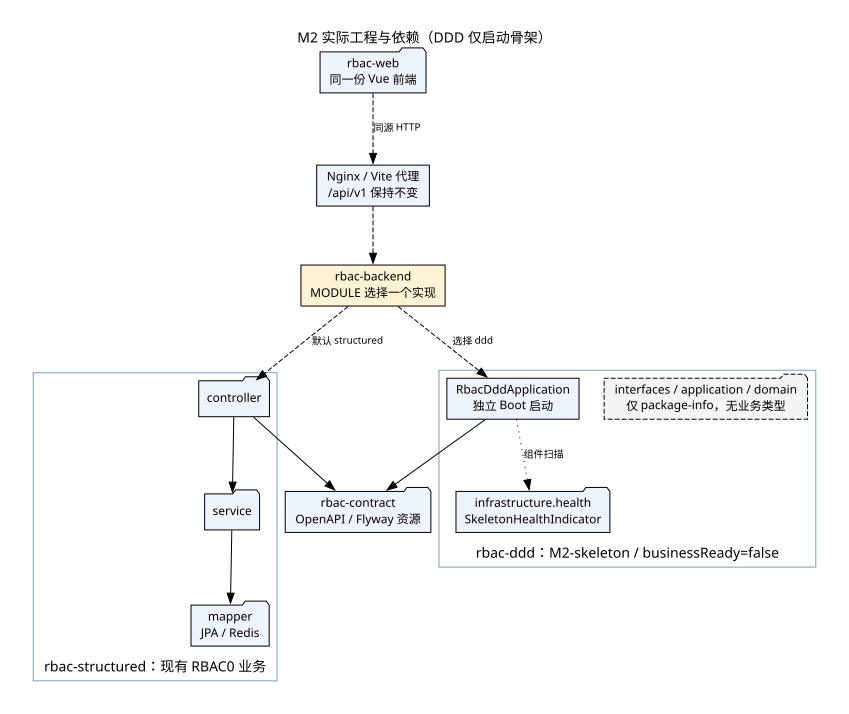

= DDD 启动骨架与后续业务架构计划
:toc:

== 边界

当前已建立可独立构建、启动的 `rbac-ddd` M2骨架，但尚无RBAC领域业务。
只有本节和“实际骨架”描述当前源码；其余角色/聚合/仓储设计仍是计划，不是业务交付声明。
旧面向对象骨架中的 rbac-oo、约束引擎、DataScope、RBAC2/3 与课程业务对象不作为现行设计依据。
以 link:requirements.adoc[需求追踪]及 link:migration-baseline.adoc[实施基线]为准；一期实况见 link:architecture-structured.adoc[结构化架构]。

== 实际骨架与验证

`RbacDddApplication`只扫描自身包；运行依赖为契约资源、Web及Actuator，不含structured、JPA、MySQL、Redis或Flyway。
`infrastructure.health.SkeletonHealthIndicator`发布health与info元数据：backend=ddd、stage=M2-skeleton、businessReady=false。
默认8082、context-path=/api/v1；SERVER_PORT可覆盖为部署的8081。
未实现登录/用户/角色等路径返回404；只暴露health/info，不暴露env/beans/metrics等运维详情。

实际HTTP及探针/架构测试21通过；包含故意违规的测试专用依赖，证明跨后端规则确实会失败，而不是空扫描通过。
domain/application/interfaces仅有package-info，不能据此声称DDD业务分层已实现。

图源为link:diagrams/packages-m2.dot[DOT]，同时有link:diagrams/packages-m2.png[PNG]，已实际打开PNG核查。
实线表示模块/分层依赖；虚线表示HTTP与选择路径；点线表示框架组件扫描，不表示角色业务调用。

== 目标分层与依赖

[source,text]
----
interfaces → application → domain
infrastructure → domain（实现仓储/外部能力端口）
启动装配组合各层，domain 不反向依赖任何外层
----

[cols="1,3"]
|===
|目标层 |职责及禁止事项
|interfaces |HTTP 入参、响应与异常映射，不计算角色闭包或准入。
|application |用例编排、事务边界、身份上下文、调用仓储及领域行为，不复制核心业务判断。
|domain |聚合、实体、值对象、领域策略及仓储端口；*无 Spring、JPA、Redis、HTTP 等技术依赖*，不使用持久化注解或框架基类。
|infrastructure |JPA 持久化记录与领域对象转换、Redis 缓存、JWT/外部 HTTP 适配、日志和端口实现；不侵入领域模型。
|===

领域仓储端口不能继承 JpaRepository；持久化实体不能冒充领域聚合。
M2已有跨后端依赖的ArchUnit及反例验证；后续仍需领域层框架无关规则和无容器业务单测，当前不能拿空领域包冒充这些验证。

== 六组设计目标

下列名称是候选职责，不表示类或接口已存在。

[cols="1,3"]
|===
|场景 |计划中的领域责任
|S01 继承加边 |RoleGraph 管理同系统 senior→junior DAG 不变量及可达性验环；基础设施提供锁/持久化能力，应用事务协调，必须验证并发反向加边。
|S02 部门准入指派 |DepartmentEligibility 策略检查直接角色资格；User 的指派行为拒绝不合资格角色；移部门回收不合资格指派，不改 Role 的共享定义。
|S03 有效权限 |Role/RoleGraph 计算直接、继承及有效集合，去重并保留来源，停用节点切断路径；不引入业务部门数据范围。
|S04 课程网关 |领域策略按系统与登记操作判定；可信网关由路由解析 operationId，不信客户端伪造值。课程对象级权限仍归课程 Service。
|S05 审计接收 |审计事实及幂等内容规则由领域表达；数据库 requestId 唯一约束保证并发重试，应用同步提交后响应；不引入异步消息替代权威写入。
|S06 敏感业务 |领域行为产出真实业务事实；应用以同一数据库事务保存业务与成功审计；失败/拒绝审计另行处理，不能伪造成功。
|===

用户唯一所属部门；角色归属系统；UI 菜单/按钮树与角色 DAG 分离；UI 权限与 API 权限为独立集合，显式映射而不互相推论。
不为凑模式数量引入责任链、约束或多租户；具体聚合边界、锁粒度与 UML 应随实现和测试补齐。

== CloneFactory 源码核验（尚未接入）

已核对参考仓库 `854d0e09e250bc5462267f63ecacdcff32161104` 的clonefactory：
依赖 `cn.edu.xmu:clonefactory:0.0.1-SNAPSHOT`，Java21，javapoet1.13.0；生成类为
`cn.edu.xmu.clonefactory.util.CloneFactory`，须在annotationProcessorPaths显式配置处理器。

源码按getX/setX访问器生成浅拷贝，不支持record accessor、标准boolean isX或自动类型转换。
当前我方record DTO不能直接假设可复制；后续需使用安全边界Bean并先写独立编译/映射测试。
copyNotNull只适用包装类型，primitive可能生成非法null比较；白名单/排除优先级、ID/actor/密码不可覆盖都要实际验证。
字段复制不替代领域构造和业务行为，不能把旧结构化Entity复制成DDD领域模型。
未安装依赖、未运行处理器，不宣称CloneFactory已集成。

== 双后端一致性门槛（待建设）

两后端独立构建、启动，共用契约、逻辑数据库模型、迁移定义及共享黑盒夹具；不得共享角色闭包、准入等核心业务 Service/算法来抹平范式差异。
相同外部请求应具有相同状态码、决策、审计与事务结果；使用相同逻辑夹具、各自隔离实例验证，而非两个实现同时污染一套测试数据。
M2已落地同前端配置选择与DDD启动参数；真实浏览器在桌面/手机均能通过同源代理取得DDD身份，且登录业务仍404。
这仅证明UI-01的连通子项，不证明两后端业务等价；M2验证结果不能替代RBAC1或两系统联调验收。
验收与证据要求见 link:test-plan.adoc[测试计划]。
